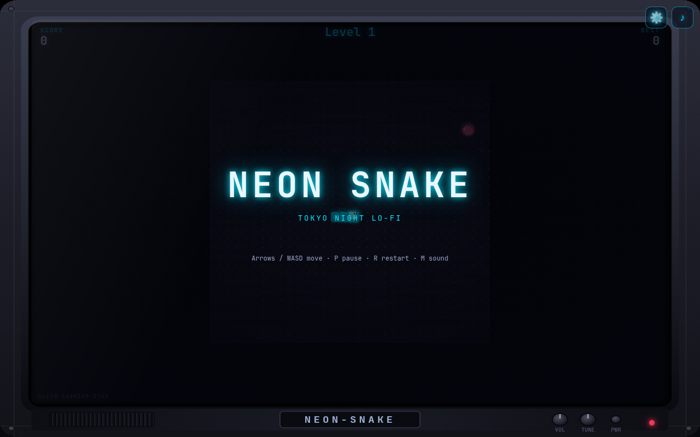
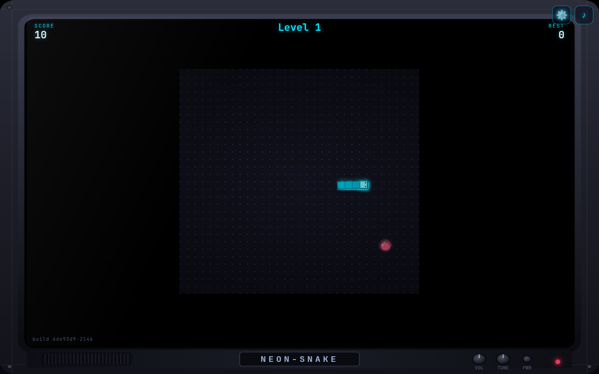
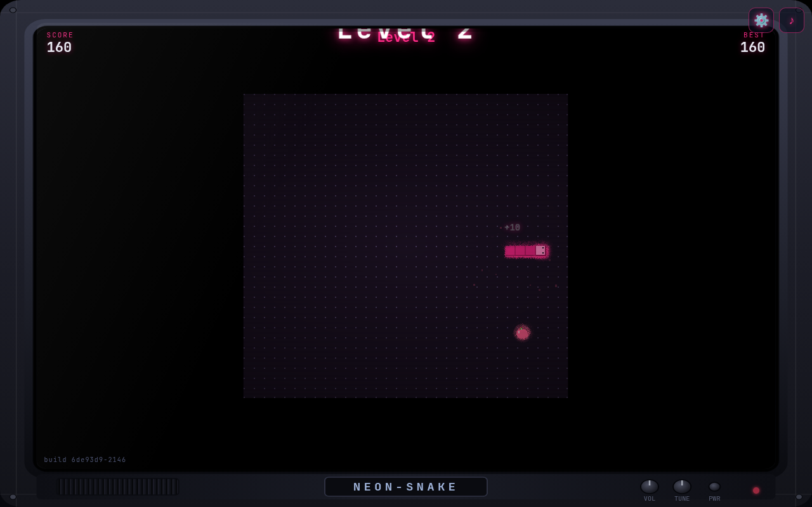
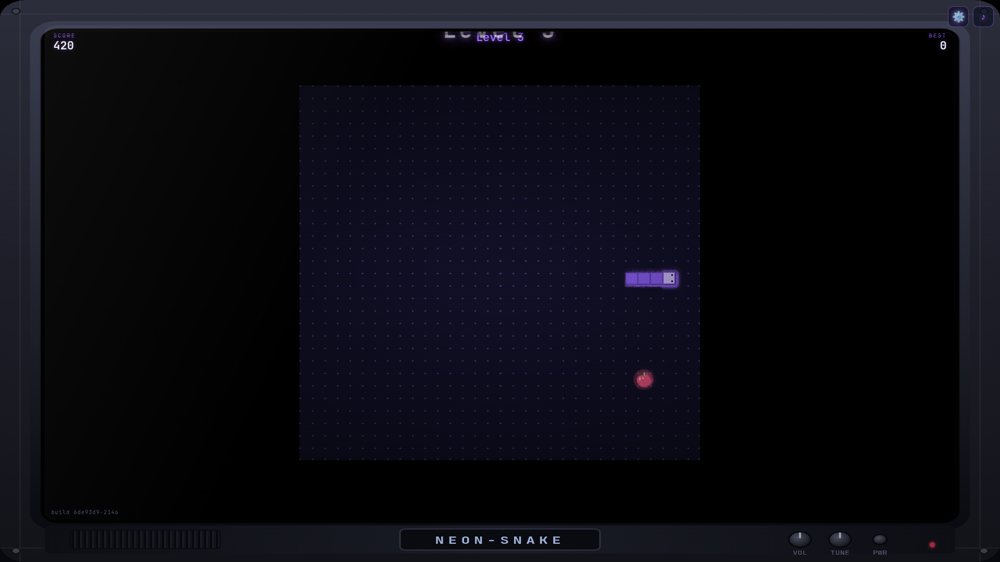

# neon snake (claude-code-fable build)

A neo-retro **2D 8-bit snake** in a Tokyo Night Neon lo-fi skin. Pure
integer simulation, engine-rendered neon FX (Phaser 4), procedural lo-fi
music and SFX (Tone.js), a CRT-TV shell drawn as an SVG sprite. No image
assets: every sprite is drawn from code.

**Play it live:** <https://kinncj.github.io/neon-snake/claude-code-fable/>



| L1 midnight-cyan | L2 neon-magenta | L3 electric-violet (1080p) |
|---|---|---|
|  |  |  |

## Run it

```bash
make bootstrap   # npm ci
make build       # production build -> dist/ (relative base: runs from any sub-path)
make preview     # serve the production build on :4173
npm run dev      # Vite dev server on :4174
```

## Play

- **Move** — arrow keys / WASD, gamepad (d-pad, left stick, face buttons),
  swipe, or the on-screen d-pad (enable it in settings).
- **Pause** — `P` / `Esc`. **Restart** — `R`. **Sound** — `M` or the ♪ button.
- **Settings** — the gear (⚙, top-right) opens a pause-on-open panel with
  four persisted toggles: **Effects**, **Sound**, **D-pad**, **FPS**.
  Defaults: Effects + Sound on, D-pad + FPS off.
- **Eat** apples (+10), oranges (+20), golden apples (+40). Chain eats
  within six ticks to build a **combo** up to ×4.
- **Levels** rise with the score (150 / 400 / 800 / 1500): the snake
  speeds up, the food changes, the whole room **re-tints** through five
  neon palettes, and the music **crossfades** to the next lo-fi track
  (70 → 86 bpm).
- Hit a **wall** → sparks fly off the wall, a local flash, shake, shockwave,
  boom. Bite **yourself** → chomp and a spray of blood. Both dissolve into
  the gameover panel.
- UI in **English, Japanese, Spanish** (browser language, or `?lang=ja`).

## Quality tiers

A capability probe (WebGL2, texture size, cores) picks a start tier and a
rolling-median frame governor moves it at runtime. `prefers-reduced-motion`
or the Effects toggle forces `reduced`.

| Tier | Runs |
|---|---|
| low / reduced | the 2D integer-scaled composite only (reduced: nothing moves but the snake) |
| high | Phaser layer: neon blocks with glow, food halo, particles, shockwaves, camera shake |
| ultra | + CRT scanline overlay with a slow flicker and a soft corner vignette |

The 2D composite is always drawn beneath the engine canvas, so an engine
failure never means a black screen; a once-a-second watchdog falls back to
the 2D path if the engine stops drawing and retries later.

## Engineering

- **Pure domain** — `app/domain/**` is a deterministic integer simulation
  with no DOM, timers, `Math.random`, audio or rendering (lint-enforced).
  It steps one fixed tick at a time; the renderers and audio only read
  state and the effect stream.
- **Replays** — `tests/fixtures/run-a.log` (526 intents over 5000 ticks)
  replays to hash `52b1ba03` on independent engine instances and at every
  quality tier.
- **Engines as adapters** — Phaser 4 (ADR 0007) draws the FX layer into one
  transparent WebGL canvas; Tone.js synthesises everything, created only
  on the first gesture. Exactly two runtime dependencies.
- **Budgets** — ≤ 12 GPU draw batches at ultra (10 measured), p95 frame
  work < 16.7 ms at low under 4× CPU throttle (1.6 ms measured), ≤ 3
  full-frame luminance transitions per second during death (0 measured),
  ≤ 500 KB gzipped (476 KB), time to first tick ≤ 1.5 s (0.25 s local).

### Docs

- [`docs/build-report.md`](docs/build-report.md) — every gate with its
  command, measured number and budget, plus deviations.
- [`docs/adr/`](docs/adr/) — 0001 screen-space effects, 0003 levels /
  combo / death cause, 0004 i18n, 0005 theming, 0006 game-library
  decision, 0007 Phaser 4 + Tone.js.
- [`docs/game/`](docs/game/) — levels, themes, collision FX, audio;
  [`docs/i18n.md`](docs/i18n.md).
- [`docs/build-log.md`](docs/build-log.md) — per-step durations from
  `docs/build-log.tsv` (`make timeline`).
- [`docs/screenshots/`](docs/screenshots/) — playtest captures
  (`SHOTS=1 npx playwright test --project=chromium tests/e2e/screenshots.spec.ts`).

### Tests

```bash
make ci          # lint, typecheck, unit + perf, build, e2e (Chromium + Firefox)
make bench       # the node-side frame budget and allocation checks
make timeline    # render docs/build-log.tsv into docs/build-log.md
```

Unit: 23 files / 134 tests (domain, replay, loop, governor, i18n, theme,
audio, songs, particles, walk, input, high score, bundle budget). E2E:
Playwright on Chromium and Firefox (WebKit auto-skips when its system
libraries are missing): gameplay, touch, HUD, i18n, settings, shell,
effects, tiers, themes, collision FX, audio, perf, viewport matrix.
