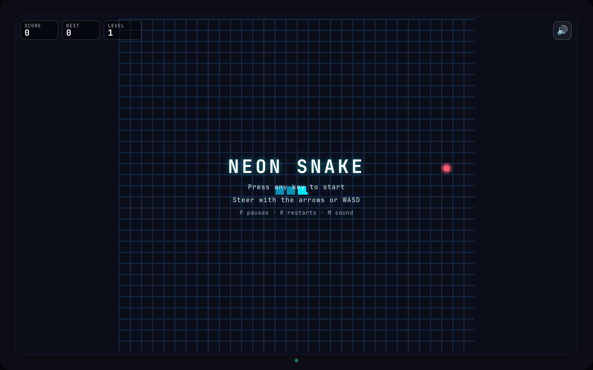
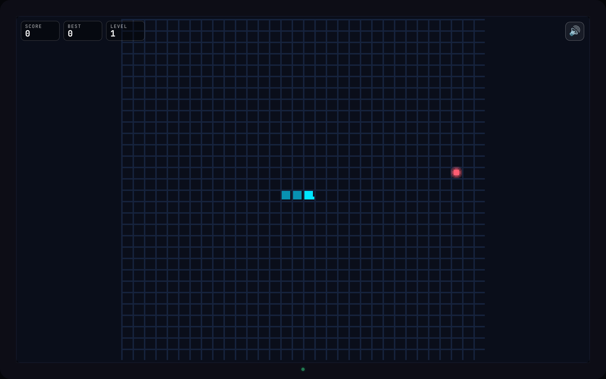
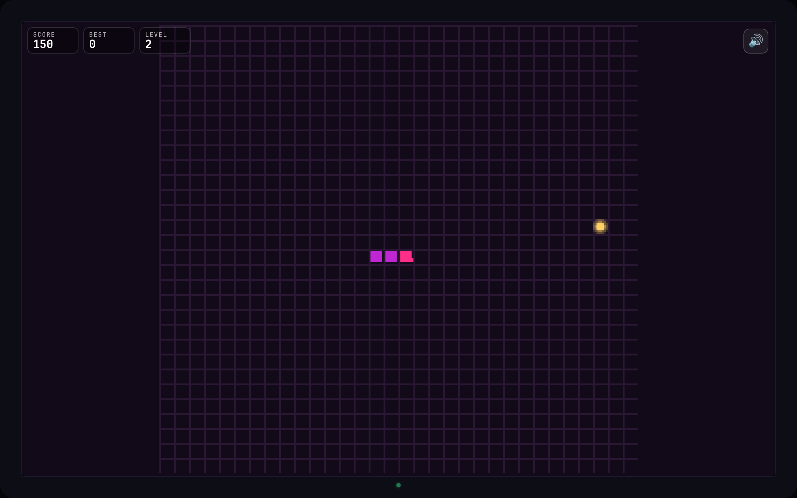
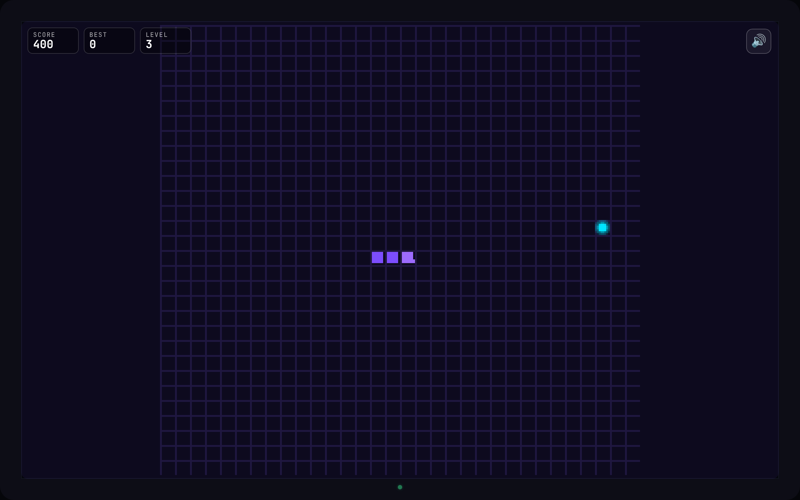

# neon snake (claude-code-qwen3.8 build)

A neo-retro **2D 8-bit snake** in a Tokyo Night Neon lo-fi skin. Pure
integer simulation, engine-rendered neon FX (Phaser 4), procedural lo-fi
music and SFX (Tone.js), a CRT-TV shell drawn as an SVG sprite. No image
assets: every sprite is drawn from code.

Generated end-to-end from [`../PROMPT.md`](../PROMPT.md) by the **Claude
Code** harness driving **Qwen3.8 27B (NVFP4)** — the Unsloth
`Qwen3.8-27B-NVFP4` quantization on an NVIDIA RTX PRO 6000 — in one
session. Same harness as the [`claude-code-fable/`](../claude-code-fable/)
baseline, different model.

**Play it live:** <https://kinncj.github.io/neon-snake/claude-code-qwen3.8/>



| L1 midnight-cyan | L2 neon-magenta | L3 electric-violet |
|---|---|---|
|  |  |  |

## Run it

```bash
make bootstrap   # npm ci
make build       # production build -> dist/ (relative base: runs from any sub-path)
make preview     # serve the production build on :4173
npm run dev      # Vite dev server on :4174
```

## Play

- **Move** — arrow keys / WASD, gamepad, swipe, or the on-screen d-pad
  (enable it in settings).
- **Pause** — `P` / `Esc`. **Restart** — `R`. **Sound** — `M` or the ♪ button.
- **Settings** — the gear (top-right) opens a pause-on-open panel with
  persisted toggles: **Effects**, **Sound**, **D-pad**, **FPS**, plus the
  language.
- **Eat** apples, oranges and golden apples. Chain eats within six ticks to
  build a **combo** up to ×4 (a golden apple at ×4 is 160 points).
- **Levels** rise with the score (150 / 400 / 800 / 1500): the snake speeds
  up, the room re-tints through five neon palettes, and the music
  crossfades to the next lo-fi track (70 → 86 bpm).
- Hit a **wall** → spark burst, flash, shake, boom. Bite **yourself** →
  chomp. Both dissolve into the game-over panel.
- UI in **English, Japanese, Spanish**.

## Engineering

- **Pure domain** — `app/domain/**` is a deterministic integer simulation
  with no DOM, timers, `Math.random`, audio or rendering (lint-enforced by
  `scripts/domain-boundary.mjs`). Seeded xorshift32 PRNG, preallocated
  `Int32Array` buffers, a bounded effect ring and an FNV-1a replay hash.
- **2D ground truth** — the Canvas2D composite is always drawn; the Phaser
  WebGL FX layer is a tier-gated overlay (ADR 0001), so an engine failure
  never means a black screen.
- **Engines as adapters** — Phaser 4 and Tone.js are the only runtime
  dependencies (ADR 0007); audio is created on the first gesture.
- **Budgets** (from [`docs/build-report.md`](docs/build-report.md)) —
  p95 frame work 0.80 ms at low tier under 4× CPU throttle (< 16.7 ms),
  retained-heap Δ ≈ 221 KB over 600 frames (< 256 KB, bounded),
  484.57 KB gzipped (≤ 500 KB).

### Docs

- [`docs/build-report.md`](docs/build-report.md) — every gate with its
  command, measured number and budget, plus deviations and limitations.
- [`docs/adr/`](docs/adr/) — 0001 screen-space effects, 0003 levels /
  combo / death cause, 0004 i18n, 0005 theming, 0006 collision FX / smooth
  walk / CRT, 0007 Phaser 4 + Tone.js.
- [`docs/game/`](docs/game/) — levels, themes, collision FX, audio;
  [`docs/i18n.md`](docs/i18n.md).
- [`docs/build-log.md`](docs/build-log.md) — per-step durations from
  `docs/build-log.tsv` (`make timeline`).
- [`docs/screenshots/`](docs/screenshots/) — playtest captures.

### Tests

```bash
make ci          # lint, typecheck, unit, build, e2e (Chromium + Firefox)
make bench       # frame-time and allocation budgets via CDP
make timeline    # render docs/build-log.tsv into docs/build-log.md
```

Unit: 19 files / 127 tests (domain, replay, loop, quality, i18n, theme,
synth, songs, particles, walk, framebuffer, high score). E2E: 12 specs /
27 tests on Chromium and Firefox (WebKit is skipped: its system libraries
are missing on the build host).
