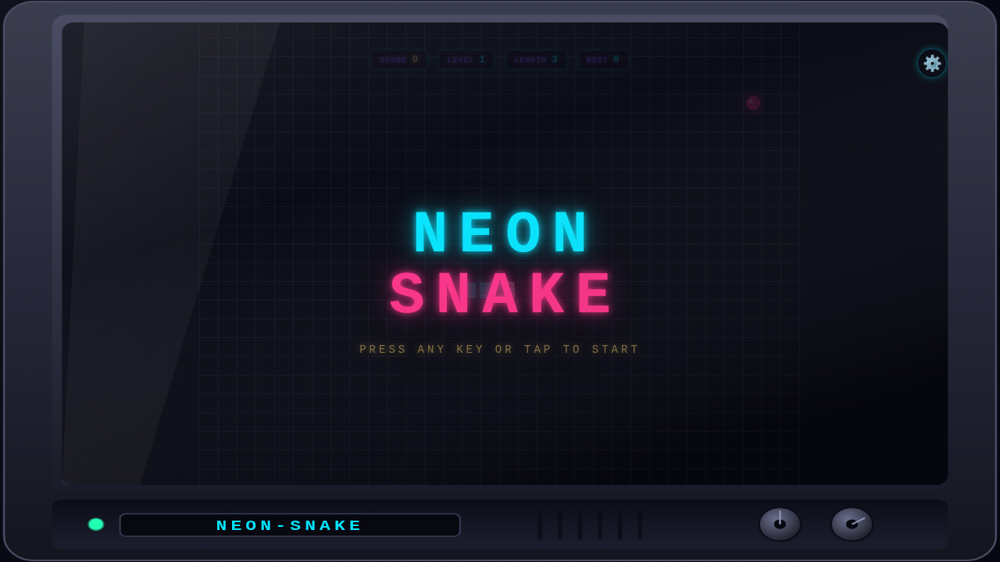
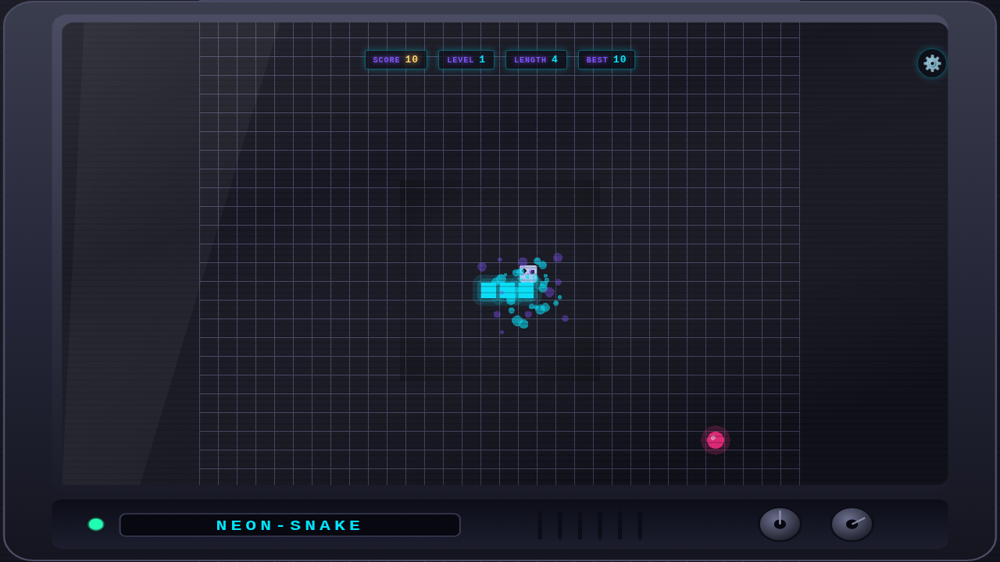
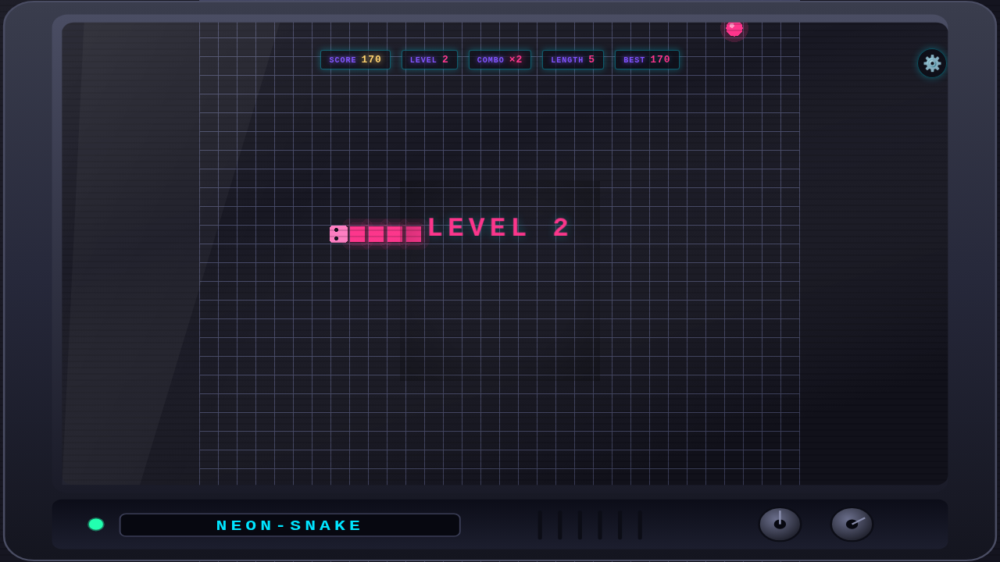
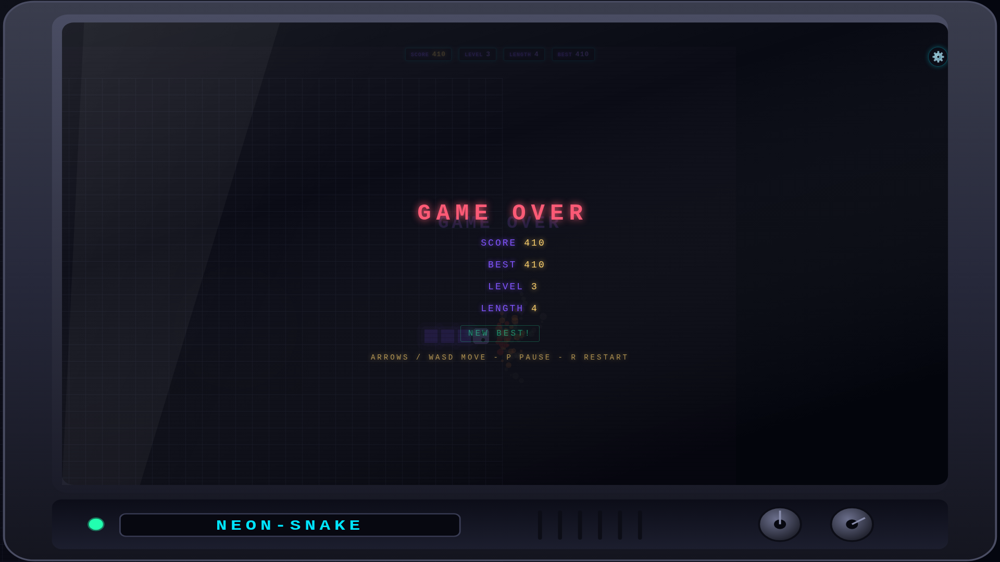

# neon snake (opencode build)

A neo-retro 2D snake in a **Tokyo Night Neon lo-fi** skin. Pure integer
simulation, engine-rendered neon FX (Phaser 4), procedural lo-fi music (Tone.js)
— no image assets, fully procedural.

**Play it live:** <https://kinncj.github.io/neon-snake/opencode/>



| L1 midnight-cyan | L2 neon-magenta | L3 electric-violet |
|---|---|---|
|  |  |  |

## Run it

```bash
make bootstrap   # npm ci
make build       # production build -> dist/
make preview     # serve on :4173
```

Development server: `npm run dev` (Vite). The production build uses a relative
base, so `dist/` runs from any sub-path (it is deployed as-is to GitHub Pages).

## Play

- **Move** — arrow keys / WASD, gamepad, or swipe / the on-screen d-pad.
- **Pause** — `P` / `Esc`. **Restart** — `R`.
- **Settings** — the gear (⚙, top-right) opens a pause-on-open panel to toggle
  **Effects** (FX on/off), **Sound** (mute), **D-pad** (on-screen pad), and
  **FPS** (performance meter). Defaults: Effects + Sound on, D-pad + FPS off.
- **Eat** apples (+10), oranges (+20), golden apples (+40). Chain eats within a
  few ticks to build a **combo** (up to ×4).
- **Levels** rise with your score: the snake speeds up, the food changes, the
  whole room **re-tints** (five neon palettes), and the **music shifts** to the
  next lo-fi track (70 → 86 bpm jazz-extended chords).
- Hit a **wall** → sparks, shake, shockwave. Bite **yourself** → chomp and
  blood. Both end the run with a dissolve and the gameover panel.

## Quality tiers

The game probes your machine (WebGL2, texture size, cores) and starts on
**low / high / ultra**, then a rolling-median frame governor escalates or
de-escalates at runtime. `prefers-reduced-motion` (or the settings panel's
Effects toggle) forces the reduced tier: engine FX off, 2D path only. If the
engine ever fails to render, it degrades to the 2D path (never a black screen).

| Tier | Runs |
|---|---|
| low | 2D integer-scaled composite only |
| high | Phaser engine: snake/food/grid/particles, camera shake + flash |
| ultra | + CRT scanline overlay, radial vignette, luminance flicker |

## Engineering

- **Pure domain** — `app/domain/**` is a deterministic integer simulation with
  no DOM/timers/`Math.random`/audio/rendering (lint-enforced). One fixed tick
  at a time; the render and audio layers only *read* state and events.
- **Engine-rendered FX** — the neon FX/game layer is **Phaser 4**: it draws the
  game into one WebGL canvas, owns WebGL context-loss recovery, and the 2D
  composite is always drawn beneath it as the guaranteed fallback (ADR 0007).
  This is what fixes the "FX on = black screen" failure.
- **Audio on Tone.js** — PolySynth/MonoSynth/MembraneSynth/NoiseSynth voices,
  a compressor-glued master, low-pass music + SFX buses, a lookahead scheduler,
  and a 250 ms crossfade between per-level songs. The `AudioContext` is created
  only on the first gesture, so the autoplay rule holds.
- **Replays** — a recorded input log replays to a fixed state hash at any
  quality tier (tier-independent simulation).
- **Cross-browser** — tested on Chromium and Firefox (WebKit auto-skips when
  its system libs are absent). Engine failures degrade gracefully to the 2D
  path; a black-frame watchdog auto-recovers.
- **Budgets** — ≤12 GPU draw batches at ultra, p95 < 16.7 ms, ~zero steady-
  state allocation (the engine ticker is paused when FX is off), ≤500 KB
  gzipped bundle (Phaser + Tone.js are the bulk of it).

### Docs

- [`docs/build-report.md`](docs/build-report.md) — full build report, budgets, gates.
- [`docs/adr/`](docs/adr/) — architecture decisions (screen-space effects,
  levels/combo, i18n, theming, game-library decision, Phaser engine + audio
  analysis).
- [`docs/build-log.md`](docs/build-log.md) — per-step build log (from
  `docs/build-log.tsv` via `make timeline`).
- [`docs/screenshots/`](docs/screenshots/) — playtest screenshots.

### Tests

```bash
make ci          # lint, typecheck, unit, build, e2e
make timeline    # render the per-step build log into markdown
SHOTS=1 npx playwright test --project=chromium tests/e2e/screenshots.spec.ts
```

Unit tests cover the domain, themes, buffers, input, and i18n. E2E tests
(Playwright) verify gameplay, HUD, i18n, effects, themes, collision FX, audio,
perf budgets, and viewport behaviour across the browser matrix.
